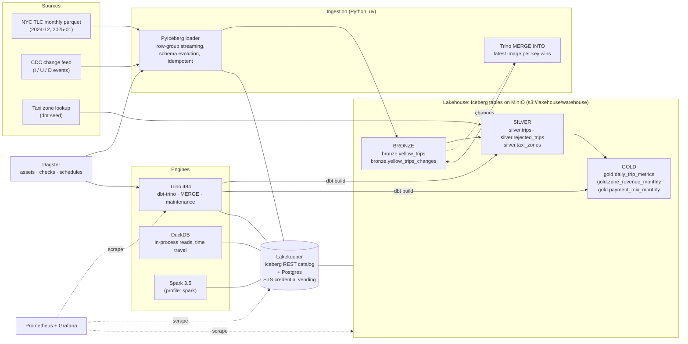

# lakehouse-blueprint

[](https://github.com/RatulSikder97/lakehouse-blueprint/actions/workflows/ci.yml)


A local-first open lakehouse with the same shape as a production one. One command
(`make demo`) brings it up, loads 7.1 million real NYC taxi trips into Apache Iceberg, applies a
CDC change feed with `MERGE`, builds bronze, silver and gold with dbt, runs quality gates,
queries the same tables from Trino and DuckDB (time travel included), and compacts and
expires the tables.

It replaces my old Hadoop/HDFS lab. Ten years on, the pieces have changed:

| 2015 lab | This blueprint |
|---|---|
| HDFS | S3-compatible object storage (MinIO) |
| Hive tables + Metastore | Apache Iceberg v2 tables behind an **Iceberg REST catalog** (Lakekeeper) |
| MapReduce / Hive on Tez | **Trino** for distributed SQL, **DuckDB** in-process, Spark optional |
| Oozie | **Dagster** software-defined assets, asset checks, schedules |
| Hand-written HiveQL scripts | **dbt** models with tests, docs and source freshness |
| "Hope the partition is right" | ACID commits, MERGE, snapshots, time travel, schema evolution |

## Architecture



Every engine reaches the warehouse through the same REST catalog. None of them has S3
keys: Lakekeeper holds a bucket-scoped MinIO identity and vends short-lived STS credentials
with each `loadTable` response ([ADR 0002](docs/adr/0002-lakekeeper-rest-catalog.md)).

## Stack (pinned)

| Layer | Component | Version | Notes |
|---|---|---|---|
| Object storage | MinIO (Chainguard build) | `RELEASE.2026-11-23`, pinned by digest | [ADR 0004](docs/adr/0004-minio-image-provenance.md) |
| Table format | Apache Iceberg | format v2 | [ADR 0001](docs/adr/0001-iceberg-over-delta.md) |
| Catalog | Lakekeeper + Postgres | `v0.15.1` + `17.12` | Iceberg REST, STS vending |
| Distributed SQL | Trino | `484` | dbt target, MERGE, maintenance |
| Embedded SQL | DuckDB + `iceberg` ext | `2.0.1` | [ADR 0003](docs/adr/0003-duckdb-and-trino.md) |
| Ingestion | PyIceberg / PyArrow | `0.12.0` / `26.0.1` | Python 3.12, managed with uv |
| Transform | dbt-core, dbt-trino, dbt-duckdb | `1.12.7`, `1.12.0`, `1.11.1` | |
| Orchestration | Dagster + dagster-dbt | `1.13.31` / `0.29.31` | profile `orchestration` |
| Heavy ETL | Spark + Iceberg runtime | `3.5.9` + `1.10.1` | profile `spark` |
| Observability | Prometheus, Grafana | `v3.16.0`, `12.4.15` | profile `observability` |

Python dependencies are locked in `uv.lock`. Images are pinned by tag or digest.

## Quickstart

Prerequisites: Docker with about 6 GB of memory available, GNU make, and
[uv](https://docs.astral.sh/uv/) (needed only for the tests and lint, not for the demo).

```bash
git clone https://github.com/RatulSikder97/lakehouse-blueprint.git
cd lakehouse-blueprint
make demo     # up -> ingest -> cdc -> transform -> checks -> showcase -> maintain
make clean    # stop everything and delete the volumes (docker compose down -v)
```

To run the steps one at a time:

```bash
make up                          # MinIO, Postgres, Lakekeeper, Trino (waits for healthy)
make ingest                      # 2024-12 + 2025-01 into bronze (MONTHS=..., LIMIT=n for a slice)
make cdc                         # land a change feed, MERGE it into bronze
make transform                   # dbt source freshness + dbt build on Trino
make checks                      # Soda-style quality checks
make showcase                    # snapshots, schema evolution, time travel, gold marts
make maintain RETENTION=7d       # optimize, optimize_manifests, expire_snapshots, remove_orphan_files
make sql Q="select count(*) from silver.trips"
make duckdb Q="select * from lake.gold.daily_trip_metrics order by pickup_date limit 5"
make orchestration               # Dagster on http://localhost:3030
make observability               # Grafana on http://localhost:3031, Prometheus on :9090
make spark-sql                   # Spark SQL shell on the same catalog
make down                        # stop all services, keep data
```

| UI | URL |
|---|---|
| Trino | http://localhost:8080 |
| Lakekeeper (catalog UI) | http://localhost:8181/ui |
| MinIO console | http://localhost:9001 (dev-only login in `docker-compose.yml`) |
| Dagster | http://localhost:3030 |
| Grafana | http://localhost:3031 (anonymous viewer) |

Ports and memory limits can be overridden through environment variables (see `.env.example`).

## Real output

Everything below is unedited output from `make demo` on a laptop (Docker Desktop, Apple
silicon), apart from trimming. The first run took 23 minutes end to end, including the
workbench image build and the download of both monthly files. Snapshot ids and timestamps
change on every run.

### Ingest, schema evolution and CDC

```text
$ make ingest
bronze.yellow_trips <- 2024-12: 3,668,371 rows, snapshot 2199046955540241497 (68.6s)
bronze.yellow_trips <- 2025-01: 3,475,226 rows, snapshot 1984385813252321422 (10.9s, schema evolved: +cbd_congestion_fee)

$ make cdc
bronze.yellow_trips_changes <- 8,250 change events (batch cdc-2025-01-20261124T053315Z)
MERGE INTO bronze.yellow_trips: 8,000 keys -> inserted 2,000, updated 5,000, deleted 1,000; snapshot 1984385813252321422 -> 3956435467164350115
```

### dbt on Trino (bronze to silver to gold)

```text
$ make transform
1 of 1 PASS freshness of bronze.yellow_trips ................................... [PASS in 0.48s]
...
Done. PASS=45 WARN=0 ERROR=0 SKIP=0 NO-OP=0 REUSED=0 TOTAL=45
```

### Quality gate

```text
$ make checks
table                   | check                        | value     | status
------------------------+------------------------------+-----------+-------
bronze.yellow_trips     | row_count > 1000             | 7,144,597 | PASS  
bronze.yellow_trips     | missing_count(trip_id) = 0   |         0 | PASS  
bronze.yellow_trips     | duplicate_count(trip_id) = 0 |         0 | PASS  
bronze.yellow_trips     | missing_count(pickup_at) = 0 |         0 | PASS  
bronze.yellow_trips     | freshness(_ingested_at) < 2d |       118 | PASS  
silver.trips            | row_count > 1000             | 6,770,221 | PASS  
silver.trips            | duplicate_count(trip_id) = 0 |         0 | PASS  
silver.trips            | min(total_amount) >= 0       |         0 | PASS  
silver.trips            | max(trip_seconds) <= 21600   |    21,595 | PASS  
silver.trips            | avg(trip_miles) < 10         |      3.25 | PASS  
silver.rejected_trips   | row_count < 400000           |   374,376 | PASS  
gold.daily_trip_metrics | row_count >= 28              |        62 | PASS  
gold.daily_trip_metrics | min(trips) > 0               |    52,240 | PASS  
gold.daily_trip_metrics | missing_count(revenue) = 0   |         0 | PASS  
(14 rows)

14/14 checks passed without failure
```

### Iceberg snapshots on bronze

PyIceberg streams each monthly file row group by row group inside one transaction (one
`append` per row group, committed atomically). The CDC `MERGE` is a single `overwrite`
snapshot that writes 7,000 rows (2,000 inserts plus 5,000 updated rows) and 6,000
position deletes (5,000 old row versions plus 1,000 deleted trips).

```sql
-- engine: trino
SELECT committed_at, snapshot_id, operation,
       element_at(summary, 'added-records') AS added_records,
       element_at(summary, 'deleted-records') AS deleted_records,
       element_at(summary, 'added-position-deletes') AS added_pos_deletes,
       element_at(summary, 'total-records') AS total_records
FROM lakehouse.bronze."yellow_trips$snapshots"
ORDER BY committed_at;

committed_at              | snapshot_id         | operation | added_records | deleted_records | added_pos_deletes | total_records
--------------------------+---------------------+-----------+---------------+-----------------+-------------------+--------------
2026-11-24 05:32:47+00:00 | 8853718019868765089 | append    |       1048576 | NULL            | NULL              |       1048576
2026-11-24 05:32:49+00:00 | 7084581154585346392 | append    |       1048576 | NULL            | NULL              |       2097152
2026-11-24 05:32:54+00:00 | 1925747755178698586 | append    |       1048576 | NULL            | NULL              |       3145728
2026-11-24 05:32:55+00:00 | 2199046955540241497 | append    |        522643 | NULL            | NULL              |       3668371
2026-11-24 05:33:02+00:00 | 8489305972847356172 | append    |       1048576 | NULL            | NULL              |       4716947
2026-11-24 05:33:03+00:00 | 6692929910710925945 | append    |       1048576 | NULL            | NULL              |       5765523
2026-11-24 05:33:05+00:00 | 9091682425248776559 | append    |       1048576 | NULL            | NULL              |       6814099
2026-11-24 05:33:05+00:00 | 1984385813252321422 | append    |        329498 | NULL            | NULL              |       7143597
2026-11-24 05:33:24+00:00 | 3956435467164350115 | overwrite |          7000 | NULL            |              6000 |       7150597
(9 rows)
```

### Schema evolution

```sql
-- engine: trino
SELECT source_month,
       count(*) AS trips,
       count(cbd_congestion_fee) AS rows_with_cbd_fee,
       round(sum(cbd_congestion_fee), 2) AS cbd_fee_total
FROM lakehouse.bronze.yellow_trips
GROUP BY source_month
ORDER BY source_month;

source_month | trips     | rows_with_cbd_fee | cbd_fee_total
-------------+-----------+-------------------+--------------
2024-12      | 3,668,371 |                 0 | NULL         
2025-01      | 3,476,226 |         3,476,226 |  1,680,538.50
(2 rows)
```

### CDC with MERGE INTO, then time travel in two engines

```sql
-- engine: trino
SELECT op, count(*) AS changes, count(DISTINCT trip_id) AS distinct_trips
FROM lakehouse.bronze.yellow_trips_changes
GROUP BY op
ORDER BY op;

op | changes | distinct_trips
---+---------+---------------
D  |    1000 |           1000
I  |    2000 |           2000
U  |    5250 |           5000
(3 rows)

-- engine: trino
SELECT batch_id, changes, inserted, updated, deleted, snapshot_before, snapshot_after
FROM lakehouse.ops.cdc_merge_log
ORDER BY applied_at DESC
LIMIT 1;

batch_id                     | changes | inserted | updated | deleted | snapshot_before     | snapshot_after     
-----------------------------+---------+----------+---------+---------+---------------------+--------------------
cdc-2025-01-20261124T053315Z |    8000 |     2000 |    5000 |    1000 | 1984385813252321422 | 3956435467164350115
(1 row)
```

```sql
-- engine: trino
SELECT 'before_merge' AS version, count(*) AS trips, round(sum(total_amount), 2) AS revenue,
       count_if(trip_id LIKE 'late-%') AS late_arrivals
FROM lakehouse.bronze.yellow_trips FOR VERSION AS OF 1984385813252321422
UNION ALL
SELECT 'current', count(*), round(sum(total_amount), 2), count_if(trip_id LIKE 'late-%')
FROM lakehouse.bronze.yellow_trips;

version      | trips     | revenue        | late_arrivals
-------------+-----------+----------------+--------------
before_merge | 7,143,597 | 192,894,813.26 |             0
current      | 7,144,597 | 192,929,677.15 |          2000
(2 rows)
```

Same snapshot, read in-process by DuckDB through the same REST catalog:

```sql
-- engine: duckdb
SELECT 'before_merge' AS version, count(*) AS trips, round(sum(total_amount), 2) AS revenue
FROM lake.bronze.yellow_trips AT (VERSION => 1984385813252321422)
UNION ALL
SELECT 'current', count(*), round(sum(total_amount), 2)
FROM lake.bronze.yellow_trips;

version      | trips     | revenue       
-------------+-----------+---------------
before_merge | 7,143,597 | 192,894,813.26
current      | 7,144,597 | 192,929,677.15
(2 rows)
```

A trip that was corrected twice in the same batch. Deduplication keeps the latest image:

```sql
-- engine: trino
WITH twice AS (
    SELECT trip_id FROM lakehouse.bronze.yellow_trips_changes
    WHERE change_batch_id = 'cdc-2025-01-20261124T053315Z' AND op = 'U'
    GROUP BY trip_id HAVING count(*) = 2
    ORDER BY trip_id LIMIT 1
)
SELECT 'before_merge' AS version, t.trip_id, t.tip_amount, t.total_amount, t._batch_id
FROM lakehouse.bronze.yellow_trips FOR VERSION AS OF 1984385813252321422 t JOIN twice w ON t.trip_id = w.trip_id
UNION ALL
SELECT 'current', t.trip_id, t.tip_amount, t.total_amount, t._batch_id
FROM lakehouse.bronze.yellow_trips t JOIN twice w ON t.trip_id = w.trip_id
ORDER BY 1 DESC;

version      | trip_id          | tip_amount | total_amount | _batch_id                      
-------------+------------------+------------+--------------+--------------------------------
current      | 2025-01-03145877 |       2.25 |        26.70 | cdc-2025-01-20261124T053315Z   
before_merge | 2025-01-03145877 |       0.00 |        24.45 | ingest-2025-01-20261124T053300Z
(2 rows)
```

### Gold marts (built by dbt on Trino, read by DuckDB and Trino)

```sql
-- engine: duckdb
SELECT pickup_date, trips, revenue, avg_fare, avg_trip_minutes, credit_card_tip_pct
FROM lake.gold.daily_trip_metrics
ORDER BY revenue DESC
LIMIT 5;

pickup_date | trips   | revenue      | avg_fare | avg_trip_minutes | credit_card_tip_pct
------------+---------+--------------+----------+------------------+--------------------
2024-12-12  | 150,963 | 4,771,020.95 |    21.83 |            21.00 |               22.41
2024-12-13  | 153,039 | 4,488,427.92 |    20.14 |            18.90 |               22.44
2024-12-05  | 142,734 | 4,375,136.60 |    21.05 |            19.90 |               22.35
2024-12-11  | 137,689 | 4,257,021.59 |    21.36 |            20.30 |               22.44
2024-12-06  | 141,162 | 4,233,966.13 |    20.60 |            19.30 |               22.32
(5 rows)

-- engine: duckdb
SELECT pickup_month, borough, zone_name, trips, revenue
FROM lake.gold.zone_revenue_monthly
WHERE pickup_month = DATE '2025-01-01'
ORDER BY revenue DESC
LIMIT 5;

pickup_month | borough   | zone_name                 | trips   | revenue      
-------------+-----------+---------------------------+---------+--------------
2025-01-01   | Queens    | JFK Airport               | 134,760 | 10,907,188.10
2025-01-01   | Queens    | LaGuardia Airport         |  86,419 |  6,638,642.50
2025-01-01   | Manhattan | Midtown Center            | 161,302 |  3,864,222.86
2025-01-01   | Manhattan | Times Sq/Theatre District | 118,244 |  3,173,124.82
2025-01-01   | Manhattan | Upper East Side South     | 157,957 |  3,140,945.97
(5 rows)

-- engine: trino
SELECT pickup_month, payment_method, trips, share_of_trips_pct
FROM lakehouse.gold.payment_mix_monthly
ORDER BY pickup_month, trips DESC;

pickup_month | payment_method | trips     | share_of_trips_pct
-------------+----------------+-----------+-------------------
2024-12-01   | credit_card    | 2,707,350 |              76.97
2024-12-01   | cash           |   463,012 |              13.16
2024-12-01   | flex_fare      |   289,437 |               8.23
2024-12-01   | dispute        |    42,547 |               1.21
2024-12-01   | no_charge      |    15,266 |               0.43
2025-01-01   | credit_card    | 2,422,810 |              74.49
2025-01-01   | flex_fare      |   413,987 |              12.73
2025-01-01   | cash           |   367,854 |              11.31
2025-01-01   | dispute        |    35,725 |               1.10
2025-01-01   | no_charge      |    12,233 |               0.38
(10 rows)
```

### Maintenance

```text
$ make maintain RETENTION=0s
Iceberg maintenance (optimize <= 128MB, optimize_manifests, expire_snapshots + remove_orphan_files older than 0s)

table                       | data_files_before | data_files_after | delete_files_before | delete_files_after | snapshots_before | snapshots_after
----------------------------+-------------------+------------------+---------------------+--------------------+------------------+----------------
bronze.yellow_trips         |                18 |                2 |                   1 |                  0 |                9 |               1
bronze.yellow_trips_changes |                 1 |                1 |                   0 |                  0 |                1 |               1
silver.trips                |                 3 |                2 |                   0 |                  0 |                1 |               1
gold.daily_trip_metrics     |                 1 |                1 |                   0 |                  0 |                1 |               1
gold.zone_revenue_monthly   |                 2 |                2 |                   0 |                  0 |                1 |               1
gold.payment_mix_monthly    |                 1 |                1 |                   0 |                  0 |                1 |               1
(6 rows)
```

`optimize` folded the MERGE's position-delete file back into the data files and
bin-packed bronze from 18 files to 2. `expire_snapshots` dropped the 8 historical
snapshots. In production keep `RETENTION=7d` so time travel still covers a week.

## Medallion layers

| Layer | Tables | Written by | Contract |
|---|---|---|---|
| Bronze | `bronze.yellow_trips` | PyIceberg | Raw trips with canonical column names and pinned types. Stable `trip_id` key. Lineage columns (`source_month`, `_source_file`, `_batch_id`, `_ingested_at`). Partitioned by `identity(source_month)`. A reload replaces its month in one Iceberg transaction. |
| Bronze | `bronze.yellow_trips_changes` | PyIceberg | Append-only CDC log (`op`, `changed_at`, row image), applied with `MERGE`. Every apply is audited in `ops.cdc_merge_log` with its before and after snapshot ids. |
| Silver | `silver.trips`, `silver.rejected_trips` | dbt on Trino | Typed (money as `DECIMAL(12,2)`) and enriched. Each row is checked against six rules; failures go to quarantine with a reason, and every bronze row lands in exactly one of the two tables (singular test). Partitioned by `pickup_month`. |
| Silver | `silver.taxi_zones` | dbt seed | 265-zone dimension. |
| Gold | `daily_trip_metrics`, `zone_revenue_monthly`, `payment_mix_monthly` | dbt on Trino | Marts for BI and DuckDB. Gold revenue must reconcile with silver to the cent (singular test). |

Schema evolution is handled for real. TLC added `cbd_congestion_fee` (the Manhattan
congestion-pricing charge) to the January 2025 file. Ingestion picks it up with
`union_by_name`, older months read it as `NULL`, and silver coalesces it to `0`. Column-name
drift (`Airport_fee` vs `airport_fee`) is canonicalised before it can split a column in two.

## Data quality, in three layers

1. **dbt tests (45 nodes)**: `not_null`, `unique`, `accepted_values`, `relationships`
   (trips to zones), custom generic tests (`non_negative`, `value_between`,
   `unique_combination`), singular tests (revenue reconciliation, silver/quarantine
   exclusivity), and **source freshness** on `_ingested_at` (warn after 26h, error after 50h).
2. **Soda-style checks** ([`quality/checks.yml`](quality/checks.yml)): a small declarative
   runner for `row_count`, `missing_count`, `duplicate_count`, `min/max/avg/sum` and
   `freshness`, with `fail` or `warn` severity
   ([`src/lakehouse/checks.py`](src/lakehouse/checks.py)). These guard published tables
   on their own schedule, separately from builds.
3. **Dagster asset checks**: a blocking uniqueness check and a months-present check on
   bronze. Every dbt test also becomes an asset check through `dagster-dbt`.

## Orchestration

[`src/lakehouse/orchestration/definitions.py`](src/lakehouse/orchestration/definitions.py)
defines:

- assets `bronze/yellow_trips` (ingestion) and `bronze/yellow_trips_changes` (CDC + MERGE),
  plus every dbt model and seed through `@dbt_assets`, with lineage wired through the dbt
  source's `meta.dagster.asset_key`;
- jobs `daily_refresh` (ingest + `dbt build`), `quality_checks_job`, and
  `iceberg_maintenance_job`;
- schedules at 06:00, 07:30 daily and Sunday 03:00 (America/New_York).

Dagster stores runs in Postgres, and the daemon runs launched jobs through a
`QueuedRunCoordinator`. `make orchestration` starts it. `daily_refresh` and
`quality_checks_job` were both launched through the daemon and finished with `SUCCESS` on
the full dataset.

## Table maintenance

Iceberg leaves maintenance to the operator, so it is part of the platform here:

- `make maintain` (Trino): `optimize` (bin-pack and fold delete files back into data
  files), `optimize_manifests`, `expire_snapshots`, `remove_orphan_files`. It prints
  file and snapshot counts before and after. The weekly Dagster job runs it with a 7-day
  retention.
- `make spark-maintain` (Spark): `rewrite_data_files`, `rewrite_position_delete_files`,
  `rewrite_manifests`, `expire_snapshots(retain_last => 5)`
  ([`infra/spark/maintenance.sql`](infra/spark/maintenance.sql)).

The local Trino catalog lowers `expire-snapshots.min-retention` and
`remove-orphan-files.min-retention` to `0s` so the demo can show their effect. Production
should keep the 7-day defaults.

## Observability

`make observability` starts Prometheus, which scrapes Trino (`/metrics`, OpenMetrics),
MinIO (cluster and bucket metrics) and Lakekeeper (`:9000/metrics`). It also starts Grafana
with a provisioned **Lakehouse overview** dashboard
([`infra/grafana/dashboards/lakehouse.json`](infra/grafana/dashboards/lakehouse.json)):
running, queued and failed queries, query throughput, cluster memory, warehouse bucket size
and object count, S3 request rate by API, S3 traffic, and catalog request and error rates
by endpoint.

## Tests and CI

| Check | Local | CI job |
|---|---|---|
| ruff (lint + format), sqlfluff (Trino dialect, Jinja templater with dbt shims) | `make lint` | `lint` |
| pytest: ingestion normalisation, row-group key stability, schema alignment, CDC feed generation, MERGE SQL safety, check parser, maintenance SQL (55 tests, fixture parquet) | `make test` | `test` |
| dbt compile + build (seed, 6 models, 38 tests) on DuckDB from a parquet fixture; `dagster definitions validate` | `make ci-dbt` | `dbt-duckdb` |
| Compose e2e: real MinIO, Lakekeeper and Trino on a 1,000-row slice (ingest, idempotent re-ingest, CDC MERGE, dbt freshness + build, checks, demo, DuckDB time-travel assertions, maintenance), then teardown | `make e2e` | `e2e` |

The raw fixtures in `tests/fixtures/` are 500 rows sampled from each real TLC month
(`scripts/make_fixtures.py`), so unit tests and CI run against the real schema drift.

## Resource requirements

Measured on Docker Desktop (Apple silicon, 12 GB VM) during `make demo`:

| Service | Limit | Observed |
|---|---|---|
| Trino | 3 GB (heap 65%) | 1.2 GB idle; reaches the limit (page cache included) under dbt/MERGE |
| MinIO | 512 MB | ~290 to 390 MB |
| Postgres | 512 MB | ~55 to 110 MB |
| Lakekeeper | 256 MB | ~25 to 45 MB |
| Workbench (ingest, dbt, DuckDB) | 3 GB | ~1.1 GB peak during ingest (row-group streaming) |
| Dagster webserver / daemon (opt-in) | 2 GB / 3 GB | ~340 MB / ~510 MB idle |
| Prometheus + Grafana (opt-in) | 512 MB each | ~100 MB + ~210 MB |
| Spark (opt-in) | 3 GB | driver 2 GB |

Disk: about 120 MB for the two raw files (cached in a volume) and about 310 MB (90
objects) in the warehouse bucket after the demo. The first run pulls about 1.4 GB of
compressed images for the core stack and builds a 2.6 GB workbench image locally.

## Mapping to AWS

| Local | AWS equivalent | What changes |
|---|---|---|
| MinIO bucket `lakehouse` | Amazon S3 (or **S3 Tables** table buckets) | Endpoint and path-style settings go away |
| Lakekeeper REST catalog | **AWS Glue Data Catalog Iceberg REST endpoint** (`https://glue.<region>.amazonaws.com/iceberg`) or S3 Tables REST; Lakekeeper on ECS Fargate + RDS Postgres if you want to keep it | Catalog URI and SigV4 auth properties |
| STS vending by Lakekeeper | Lake Formation credential vending, IAM roles per engine | Engines get scoped temporary credentials the same way |
| Trino | **Amazon Athena** (serverless Trino) or Trino/Starburst on EKS/EMR | `MERGE`, `OPTIMIZE` and `VACUUM` are supported on Athena Iceberg tables |
| DuckDB | DuckDB in Lambda or on laptops against Glue/S3 Tables (`ATTACH ... TYPE iceberg`) | Catalog endpoint and secret |
| Spark profile | **EMR Serverless** / EMR on EKS / Glue jobs | Same Iceberg procedures |
| PyIceberg ingestion | Lambda or ECS task triggered by EventBridge / S3 events | Catalog properties only |
| dbt-trino | dbt-athena (or dbt-trino on Starburst Galaxy) | Adapter profile |
| Dagster (compose) | Dagster+ Hybrid with an ECS agent, or MWAA | Run launcher |
| Prometheus + Grafana | Amazon Managed Prometheus + Amazon Managed Grafana, CloudWatch for S3/Athena | Scrape and remote-write config |
| Maintenance job | S3 Tables automatic compaction and snapshot management, or Glue table optimizers | Mostly managed |

Iceberg metadata and data files are plain objects, so moving a table is a copy plus a
catalog `register`. No reprocessing is needed.

## Architecture decisions

- [ADR 0001: Apache Iceberg over Delta Lake and Hudi](docs/adr/0001-iceberg-over-delta.md)
- [ADR 0002: Lakekeeper as the Iceberg REST catalog](docs/adr/0002-lakekeeper-rest-catalog.md)
- [ADR 0003: DuckDB for lightweight reads, Trino for distributed SQL](docs/adr/0003-duckdb-and-trino.md)
- [ADR 0004: MinIO image provenance](docs/adr/0004-minio-image-provenance.md)

## Dataset and licensing

- **NYC TLC Trip Record Data** (yellow taxi, December 2024 and January 2025) and the
  **Taxi Zone Lookup** come from the NYC Taxi & Limousine Commission
  (<https://www.nyc.gov/site/tlc/about/tlc-trip-record-data.page>). They are public data
  published under the [NYC Open Data Terms of Use](https://www.nyc.gov/home/terms-of-use.page).
  The data is provided as is, and attribution goes to NYC TLC. Raw monthly files are
  downloaded at runtime and are not stored in this repository. The repository contains a
  1,000-row test sample and the 265-row zone lookup seed.
- The CDC feed is synthetic, generated deterministically from real rows. Upstream TLC
  data has no change feed.
- Code in this repository is MIT-licensed (see [LICENSE](LICENSE)). MinIO is AGPLv3,
  Lakekeeper, Trino, Iceberg, DuckDB, dbt, Dagster and Spark are Apache-2.0 or MIT. They are
  used here as unmodified container images and packages.

## Repository layout

```
docker-compose.yml        core stack + opt-in profiles (tools, orchestration, observability, spark)
Dockerfile                workbench image: ingestion, dbt, DuckDB, Dagster
Makefile                  make up / ingest / cdc / transform / checks / maintain / demo / down / clean
infra/                    trino catalog + jvm, lakekeeper/minio/postgres bootstrap, prometheus, grafana, dagster, spark
src/lakehouse/            ingest.py, cdc.py, checks.py, maintenance.py, duck.py, demo.py, cli.py, orchestration/
transform/                dbt project (sources, silver, gold, seeds, generic + singular tests, macros)
quality/                  Soda-style checks (full and CI-sized)
tests/                    pytest suite + raw TLC fixtures
scripts/                  e2e_smoke.sh, make_fixtures.py
docs/adr/                 architecture decision records
```

## Security notes

All credentials in `docker-compose.yml` are dev-only defaults, labelled as such, and can be
overridden through `.env`. Catalog authentication is off locally (`security=NONE`). For
any shared deployment, put Lakekeeper behind OIDC with the OpenFGA authorizer, use TLS
everywhere, and keep MinIO/S3 credentials in a secrets manager.

## License

[MIT](LICENSE)
